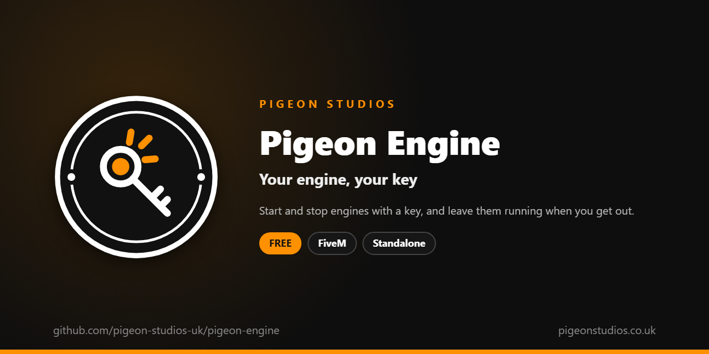

<div align="center">
  

  <h1>Pigeon Engine</h1>

  <p><strong>Start and stop engines with a key, keep them running when you get out, and leave the wheels turned.</strong></p>

  <p>
    <a href="https://github.com/pigeon-studios-uk/pigeon-engine/releases/latest"></a>
    <a href="LICENSE.md"></a>
    <a href="https://discord.gg/2NFVWEUmDF"></a>
    
  </p>

  <p>
    <a href="https://github.com/pigeon-studios-uk/pigeon-engine/releases/latest"><strong>Download</strong></a> ·
    <a href="#installation">Install</a> ·
    <a href="#configuration">Configure</a> ·
    <a href="CHANGELOG.md">Changelog</a> ·
    <a href="https://discord.gg/2NFVWEUmDF">Support</a>
  </p>
</div>

---

## Contents

- [Overview](#overview)
- [Features](#features)
- [How players use it](#how-players-use-it)
- [Requirements](#requirements)
- [Installation](#installation)
- [Updating](#updating)
- [Configuration](#configuration)
- [Vehicle keys](#vehicle-keys)
- [Exports](#exports)
- [Localisation](#localisation)
- [How it works](#how-it-works)
- [Update checker](#update-checker)
- [Performance](#performance)
- [Security](#security)
- [Troubleshooting](#troubleshooting)
- [FAQ](#faq)
- [Support](#support)
- [Contributing](#contributing)
- [Licence](#licence)
- [Credits](#credits)

## Overview

Pigeon Engine is a free resource by [Pigeon Studios](https://pigeonstudios.co.uk) that puts the engine in the driver's hands. In GTA, getting in starts the engine and getting out often stops it. With this resource, drivers start and stop it with a key, leave it running when they hop out, and find a parked car's engine off until they start it.

Damaged engines take longer to start, sometimes don't catch, and past a point won't start at all. Parked cars keep their wheels turned the way they were left. And if you use a vehicle keys resource, one function in the config decides who can start what.

## Features

- **One key.** M by default, which players can change in GTA's key bindings, or `/engine`. The driver turns the key for a moment, and the engine starts.
- **Keeps running.** Get out and the engine keeps going: always, only if you hold the exit key, or never.
- **Stays off.** A parked car's engine stays off when someone gets in to drive, until they start it. Or leave GTA's own starting on.
- **Damage matters.** Damaged engines take longer to start, sometimes turn over without catching, and below a health you set won't start at all.
- **Parked properly.** The front wheels stay turned the way they were when the driver got out.
- **Vehicle keys.** `Config.CanStart` asks your keys resource whether the driver can start the vehicle.
- **Everyone sees it.** The engine is the game's own, so other players hear it running, or not.
- **Translatable.** Every message is in `locales/`.
- **Standalone.** No framework needed.

## How players use it

1. Get in to drive. If the engine was off, it stays off.
2. Press **M** (or type `/engine`). The driver turns the key, and a moment later the engine starts.
3. Press **M** again to stop it.
4. Get out with **F**. The engine keeps running, unless they stopped it. With `Config.KeepRunning = 'hold'`, a tap of F turns it off and holding F keeps it running.

To change the key: **Settings → Key Bindings → FiveM → Engine on / off**.

## Requirements

| Requirement | Version | Notes |
|---|---|---|
| FXServer | A [recommended artifact](https://runtime.fivem.net/artifacts/) | |
| [ox_lib](https://github.com/communityox/ox_lib) | Optional | Used for messages if it's running |
| A vehicle keys resource | Optional | Only if you want keys to decide who can start what (see [Vehicle keys](#vehicle-keys)) |

**Frameworks:** none needed. It works the same on standalone servers, ESX Legacy, QBCore, Qbox and ox_core.

## Installation

1. **Download** `pigeon-engine.zip` from the [latest release](https://github.com/pigeon-studios-uk/pigeon-engine/releases/latest). Don't use the green **Code** button; release zips are the tested builds.
2. **Extract** it into your server's `resources` folder. The folder must be called `pigeon-engine`.
3. **Start it** by adding this to `server.cfg`, after ox_lib and your keys resource if you use them:

   ```cfg
   ensure pigeon-engine
   ```

4. **Turn off any other engine toggle**, including one built into a keys resource or HUD, so the two don't fight over the engine.
5. **Check the settings** in `configuration/config.lua` (see [Configuration](#configuration)). Out of the box, engines stay off until started, keep running when the driver gets out, and wheels stay turned.
6. **Restart** your server. The console shows one line from the update checker:

   ```text
   [Pigeon Studios] Pigeon Engine v1.0.0 is up to date.
   ```

## Updating

1. Read the [changelog](CHANGELOG.md) for every version between yours and the latest, especially any **Upgrade notes**.
2. Back up your `configuration/` and `locales/` folders.
3. Replace the `pigeon-engine` folder with the new release.
4. Copy your settings, especially `Config.CanStart`, into the new `configuration/config.lua`. Don't copy the old file over the new one; new versions can add settings.
5. Restart the resource.

## Configuration

All settings are in `configuration/config.lua`, each with a comment explaining it.

| Setting | Default | What it does |
|---|---|---|
| `Config.Locale` | `'en'` | Language file from `locales/` to use |
| `Config.Key` | `'M'` | The default key. Players can change it in GTA's key bindings |
| `Config.Command` | `'engine'` | The command, which the key runs |
| `Config.StartSeconds` | `1.0` | How long the driver turns the key before a healthy engine starts |
| `Config.StartOnEnter` | `false` | `true` lets GTA start the engine when someone gets in to drive. `false` keeps an engine that's off, off |
| `Config.KeepRunning` | `'always'` | Getting out: `'always'` keeps it running, `'hold'` only if they hold F, `'never'` turns it off |
| `Config.HoldMs` | `500` | How long F has to be held, in milliseconds, with `'hold'` |
| `Config.KeepWheelsTurned` | `true` | Keep the front wheels turned when the driver gets out |
| `Config.Damage.enabled` | `true` | Damage makes engines harder to start |
| `Config.Damage.unreliableBelow` | `400` | Below this engine health (out of 1000), starts sometimes fail |
| `Config.Damage.worstFailChance` | `0.6` | The chance of failing just above `deadBelow`: 0.6 is 60% of tries |
| `Config.Damage.deadBelow` | `100` | Below this, the engine won't start at all |
| `Config.CanStart` | always yes | A function that decides whether the driver can start the vehicle (see [Vehicle keys](#vehicle-keys)) |
| `Config.SkipClasses` | 13, 21 | Vehicle classes left to GTA: cycles and trains |
| `Config.ShowMessages` | `true` | Short messages: engine on, off, won't start |
| `Config.Notifications` | `'auto'` | `'auto'` (ox_lib if it's running), `'ox_lib'` or `'gta'` |

## Vehicle keys

`Config.CanStart` runs in the driver's game every time they try to start an engine, with the vehicle. Return `false` to stop it, with a message if you like. Ask your keys resource whether the driver has the keys:

```lua
Config.CanStart = function(vehicle)
    local plate = GetVehicleNumberPlateText(vehicle)
    if not exports['your-keys-resource']:HasKey(plate) then
        return false, 'You don\'t have the keys.'
    end
    return true
end
```

Every keys resource names its export differently, so check its own documentation for the right one. Most keys resources also have their own engine toggle; turn that off, so only one resource controls the engine.

If your keys resource hotwires cars, have it start the engine with this resource's `SetEngine` export once the hotwire succeeds (see [Exports](#exports)).

## Exports

Client exports, for other resources in the player's game:

```lua
-- Start or stop the engine of the vehicle the player is driving, exactly as the key does.
exports['pigeon-engine']:ToggleEngine()

-- True if the vehicle the player is in has its engine running.
local running = exports['pigeon-engine']:IsEngineRunning()

-- Start (true) or stop (false) the engine of the vehicle the player is driving straight away, skipping
-- Config.CanStart and damage: for example after hotwiring.
exports['pigeon-engine']:SetEngine(true)
```

## Localisation

Change `Config.Locale` to use another language from `locales/`. To add a language, copy `locales/en.lua` to a new file named with the language's two-letter code (for example `de.lua`), change `Locales.en` to match (`Locales.de`) and translate the text in quotes. We'd love it if you shared it back; see [Contributing](#contributing).

## How it works

Everything runs in the driver's own game, using GTA's own engine.

- **Getting in.** As the player starts getting into a vehicle, the resource notes whether its engine is running. If it wasn't, and `Config.StartOnEnter` is off, it keeps the engine off once they're in the driver's seat, and stops GTA starting it on its own.
- **The key.** Pressing it stops a running engine. For one that's off, it asks `Config.CanStart`, checks the engine's health, waits while the driver turns the key (longer for a damaged engine), then starts it, or says it didn't catch.
- **Getting out.** When the driver presses F, the resource notes whether the engine was running and which way the wheels were turned, before the game starts straightening them. Once they're out, it keeps the engine running or switches it off as `Config.KeepRunning` says, and holds the wheels where they were for a moment, until the parked car settles.

Engines and wheels are synced by the game, so every player sees and hears the same thing.

## Update checker

When it starts, Pigeon Engine checks our public [version registry](https://github.com/pigeon-studios-uk/pigeon-versions) once and prints one line in the server console saying whether it's up to date. If there's an update, it shows what's new and where to get it. The check is a single request to GitHub and sends nothing about your server or players.

Control it for every Pigeon Studios resource at once in `server.cfg`:

```cfg
set pigeon_update_check "on"      # default: one short line
set pigeon_update_check "quiet"   # only print when there's an update or a problem
set pigeon_update_check "off"     # never check
```

## Performance

On foot, it checks five times a second, and every frame only while the player is getting into a vehicle or just got out. While driving, it runs every frame, which costs very little: a couple of readings about the vehicle and one key. Nothing runs on the server apart from the update check at start-up.

## Security

- It only changes the vehicle the player is driving, in their own game.
- It has no network events and no server code beyond the update check, so there's nothing players can send it.
- `Config.CanStart` runs in the player's game. Like every rule that runs there, a player with a modified game could get around it; your keys resource's own server checks are what keep cars safe.
- The only network request is the update check at start-up, from the server to GitHub. It sends nothing about your server or players.

Found a problem? Please don't open a public issue. Use the **Report a vulnerability** button in this repository's **Security** tab, or follow our [Security Policy](https://github.com/pigeon-studios-uk/.github/blob/main/SECURITY.md).

## Troubleshooting

**The engine starts by itself when I get in.**
Check `Config.StartOnEnter` is `false`. If it is, another resource is starting it, often a keys resource or HUD with its own engine toggle; turn that off.

**The engine switches off when I get out.**
Check `Config.KeepRunning`. With `'hold'`, hold F to keep it running. If it still switches off, another resource is stopping it.

**M does nothing.**
Only the driver can use it, and not on bicycles or trains. Check the key in **Settings → Key Bindings → FiveM**. Try `/engine`; if that shows a message, it says why.

**"You can't start this vehicle."**
`Config.CanStart` said no. Check your keys resource gave the player the keys, and that the export in `Config.CanStart` is the right one.

**The wheels straighten anyway.**
The vehicle has to be the player's to move in the game, which it usually is right after they drove it. If another player's game owns it, the wheels straighten as normal.

**The console says "isn't in the version registry" or "couldn't check for updates".**
Your server couldn't reach GitHub, or the check is blocked by a firewall. The resource works normally either way. Turn the check off with `set pigeon_update_check "off"`.

## FAQ

**Is it really free?**
Yes. Use it on as many servers as you like, including ones that take donations. You just can't reupload, resell or bundle it. See [Licence](#licence).

**Does it work with planes, helicopters and boats?**
Yes, any vehicle with an engine. Bicycles and trains are left to GTA.

**Can a passenger start the engine?**
No. Only the driver.

**Does it affect NPCs' cars?**
Only when a player is driving them.

## Support

Read [Troubleshooting](#troubleshooting) first, then ask in the support channels of our [Discord](https://discord.gg/2NFVWEUmDF). Please include your Pigeon Engine version, FXServer artifact, your keys resource and any errors from the console (F8 in game). See [Getting help](https://github.com/pigeon-studios-uk/.github/blob/main/SUPPORT.md).

Found a bug? Open a [bug report](https://github.com/pigeon-studios-uk/pigeon-engine/issues/new/choose).

## Contributing

Fixes, improvements and translations are welcome. Please read the [contributing guide](https://github.com/pigeon-studios-uk/.github/blob/main/CONTRIBUTING.md) first, and open a feature request before working on anything big.

## Licence

Pigeon Engine is free to use under the **[Pigeon Studios Free Licence](LICENSE.md)**.

- ✅ Use it on any number of servers, including monetised ones
- ✅ Change it for your own servers
- ✅ Show it in videos and streams
- ❌ Don't reupload, share or mirror the files; link to this repository instead
- ❌ Don't sell it, bundle it in packs, or put it behind escrow
- ❌ Don't remove the credits

This summary isn't the licence; [LICENSE.md](LICENSE.md) is. Third-party components are listed in [NOTICE.md](NOTICE.md).

## Credits

Made by [Pigeon Studios](https://pigeonstudios.co.uk). Thanks to everyone who has contributed fixes and translations; see the [changelog](CHANGELOG.md).

<sub>Not affiliated with or endorsed by Rockstar Games, Take-Two Interactive or Cfx.re.</sub>
